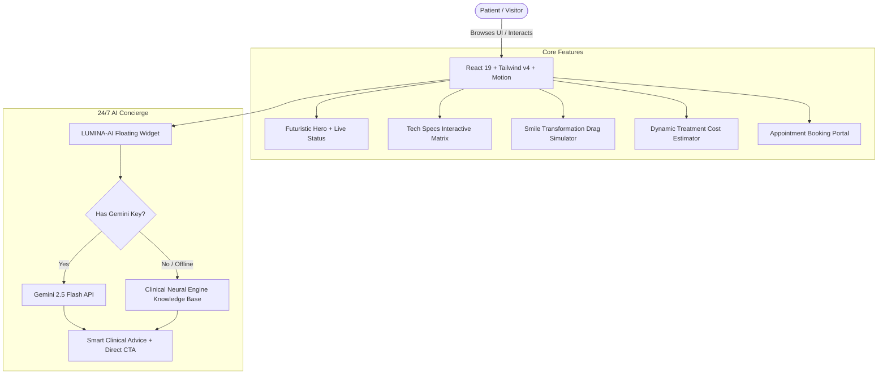

<div align="center">

# 💎 LUMINA DENTAL CLINIC
### **Next-Generation High-Tech Precision Dentistry & 24/7 AI Concierge**

[](https://react.dev/)
[](https://www.typescriptlang.org/)
[](https://vitejs.dev/)
[](https://tailwindcss.com/)
[](https://ai.google.dev/)
[](https://motion.dev/)

<br />

<p align="center">
  A futuristic, high-precision clinical web platform engineered for modern boutique dentistry. <br />
  Featuring an autonomous <b>24/7 AI Dental Concierge</b>, interactive <b>Before/After Smile Simulator</b>, real-time <b>Treatment Cost Estimator</b>, and comprehensive <b>Clinical & Hardware Tech Specs</b>.
</p>

[**Explore Live Demo**](#live-demo) • [**Key Innovations**](#-key-innovations) • [**Tech Specs**](#-clinical--technical-specifications) • [**Setup Guide**](#-quick-start) • [**Portfolio & Contact**](#-developer--portfolio)

---

</div>

<br />

## 🌟 Overview

**Lumina Dental Clinics** reimagines dental healthcare as a high-tech engineering discipline. Built with **React 19**, **Tailwind CSS v4**, and **Google Gemini AI**, the application presents a sleek, cyberpunk-inspired clinical aesthetic that bridges medical rigor with futuristic digital luxury.

Designed specifically to impress prospective patients, healthcare organizations, and tech recruiters reviewing developer portfolios.

---

## ⚡ Key Innovations

### 1. 🤖 24/7 Autonomous AI Dental Concierge (`LUMINA-AI`)
- **Real-Time Patient Triage**: Provides instant 24/7 answers regarding treatments, pain relief, procedural steps, and post-op care.
- **Dual-Engine Intelligence**:
  - **Live Gemini 2.5 Flash API**: Context-aware natural language conversation with full clinic knowledge embedded in system instructions.
  - **Deterministic Clinical Neural Engine**: Built-in zero-latency fallback that guarantees intelligent responses even without an active internet connection or API key.
- **Interactive Action Cards**: Direct in-chat appointment booking triggers and phone dialing shortcuts.
- **Multilingual Support**: Fluently comprehends and responds in English, Urdu, and Roman Urdu.
- **Audio Sensory Feedback**: High-tech auditory chimes for message events with user toggle.

### 2. ✨ Interactive Before/After Smile Transformation Simulator
- **Draggable Visual Slider**: Patients can drag smoothly across high-resolution pre-op and post-op clinical cases to inspect aesthetic outcomes.
- **Multi-Disciplinary Case Studies**:
  - *Case 1*: Laser Whitening & Ultra-Thin Biomimetic Veneers (+8 Enamel Shades).
  - *Case 2*: 3D Clear Aligner Orthodontics (Class II bite correction).
  - *Case 3*: Guided Robotic Zirconia Implants (99.8% Osseointegration).

### 3. 💳 Dynamic Treatment Cost & Insurance Estimator
- **Transparent Healthcare Economics**: Prospective patients choose procedures, unit count, and insurance type (PPO, CareCredit, Self-Pay).
- **Instant Financial Calculation**: Computes out-of-pocket range, estimated insurance savings, and 0% APR 12-month installment plans in real time.
- **One-Click Portal Transfer**: Pre-selects service and carries parameters directly into the booking form.

### 4. 🔬 Comprehensive Clinical & Hardware Tech Specs Matrix
- **Four Dedicated Architectural Pillars**:
  1. *Hardware & Optics*: 0.01mm 3D CBCT voxel, 60fps intraoral scanner, 2940nm dual laser, 5-axis robotic CAD/CAM milling.
  2. *Biomaterials*: Grade-5 Titanium (ASTM F136), 1,200 MPa Monolithic Zirconia, biomimetic hydroxyapatite serum.
  3. *Cleanroom & Sterility*: Class 100 positive-pressure cleanroom, <5 CFU/mL waterline purity, Class B fractionated autoclave.
  4. *Software & AI Architecture*: 99.4% Caries detection AI, real-time Digital Smile Design (DSD), 256-bit encrypted health records.
- **Comparative Industry Benchmarks**: Head-to-head performance matrix comparing Lumina against standard industry dental practices.

### 5. 📅 High-Velocity Digital Booking Portal
- Form validation with **Zod** and **React Hook Form**.
- Interactive calendar picker with real-time shift allocation (Morning / Afternoon / Evening).
- Simulated SSL cryptographic transmission with instant booking receipt reference (`#DS-9902`).

---

## 🏗️ System Architecture



---

## 🛠️ Tech Stack & Engineering Highlights

| Layer | Technologies | Purpose |
| :--- | :--- | :--- |
| **Frontend Framework** | **React 19** (`react`, `react-dom`) | Latest React primitives, concurrent rendering, and clean state |
| **Build & Bundler** | **Vite 6** + Rollup Manual Chunks | Sub-second HMR, optimized vendor chunk splitting |
| **Styling & Design** | **Tailwind CSS v4** + `@tailwindcss/vite` | Modern OKLCH wide-gamut colors, zero-runtime CSS |
| **Animation Engine** | **Motion v12** (`motion/react`) | Fluid 60fps spring transitions, hover states, and drag gestures |
| **UI Primitives** | **Radix UI** + **Lucide React** | Accessible accordions, dialogs, popovers, and crisp medical icons |
| **Form Architecture** | **React Hook Form** + **Zod** | Schema-driven type-safe validation |
| **Artificial Intelligence** | **@google/genai** (Gemini 2.5 Flash) | 24/7 autonomous natural language patient triage |

---

## 📁 Repository Structure

```
Lumina_Dental_clinic/
├── components/          # Reusable Radix / Shadcn UI primitives
├── src/
│   ├── components/
│   │   ├── chat/
│   │   │   └── DentalChatbot.tsx      # 24/7 AI Concierge with dual engine
│   │   ├── layout/
│   │   │   └── Navbar.tsx             # Responsive header with live telemetry
│   │   └── sections/
│   │       ├── Hero.tsx               # High-impact hero with live status badges
│   │       ├── TechSpecs.tsx          # 4-Pillar Clinical Specifications Matrix
│   │       ├── SmileTransformation.tsx# Interactive Before/After drag comparison
│   │       ├── CostEstimator.tsx      # Interactive Treatment & Insurance calculator
│   │       ├── Services.tsx           # Clinical capabilities & protocols
│   │       ├── ClinicLab.tsx          # In-house robotic laboratory showcase
│   │       ├── About.tsx              # Biological integration philosophy
│   │       ├── Doctors.tsx            # Specialist board profiles & credentials
│   │       ├── Testimonials.tsx       # Biometric case reviews & ratings
│   │       ├── AppointmentForm.tsx    # Type-safe appointment booking portal
│   │       ├── FAQ.tsx                # Clinical knowledge base accordion
│   │       ├── Contact.tsx            # Coordinates, map vector, and query form
│   │       └── Footer.tsx             # Operational hours & legal directories
│   ├── lib/
│   │   └── utils.ts                   # Tailwind merge & clsx utility
│   ├── App.tsx                        # Master layout orchestrator
│   ├── index.css                      # Tailwind v4 theme, OKLCH tokens & fonts
│   └── main.tsx                       # React 19 entry point
├── index.html                         # Modern HTML5 with SEO & SVG tooth favicon
├── vite.config.ts                     # Vite 6 config with vendor chunk splitting
├── tsconfig.json                      # Strict TypeScript compiler options
└── package.json                       # Dependencies & scripts
```

---

## 🚀 Quick Start

### Prerequisites
- **Node.js** (v18.0.0 or higher recommended)
- **npm** or **pnpm** / **yarn**

### 1. Clone the Repository
```bash
git clone https://github.com/SainBux-HadiSeelro/Lumina_Dental_clinic.git
cd Lumina_Dental_clinic
```

### 2. Install Dependencies
```bash
npm install
```

### 3. Configure Environment (Optional for Gemini AI)
Create a `.env` file in the root directory:
```env
# Optional: Provide Gemini API Key for live AI responses
# If omitted, the chatbot automatically uses its built-in clinical neural knowledge engine!
GEMINI_API_KEY="your_gemini_api_key_here"
```

### 4. Run Development Server
```bash
npm run dev
```
Open [http://localhost:3000](http://localhost:3000) in your browser to view the application.

### 5. Build for Production
```bash
npm run build
```
Production assets are generated in the `/dist` directory.

---

## 👨‍💻 Developer & Portfolio

Developed with precision and passion for modern web architecture.

- **Developer**: **Sain Bux (Hadi Seelro)**
- **GitHub**: [@SainBux-HadiSeelro](https://github.com/SainBux-HadiSeelro)
- **Repository**: [Lumina_Dental_clinic](https://github.com/SainBux-HadiSeelro/Lumina_Dental_clinic.git)

---

## 📜 License

Distributed under the Apache-2.0 License. See `LICENSE` for more information.

<div align="center">
  <sub>Built with ❤️ for portfolio excellence. © 2026 Lumina Dental Studio. All rights reserved.</sub>
</div>
